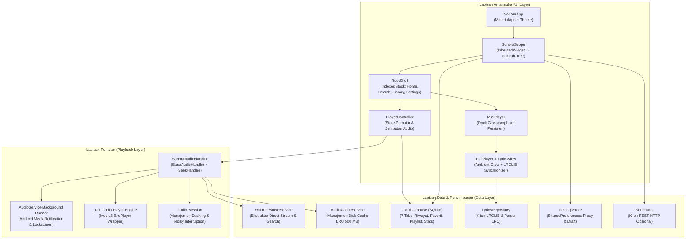
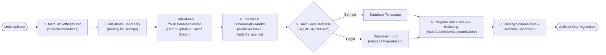
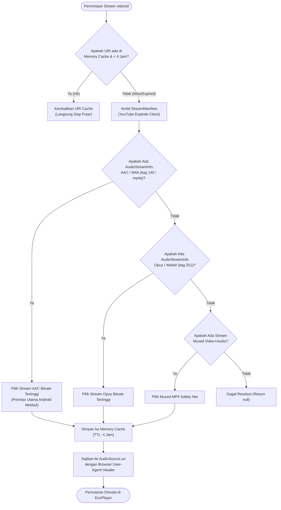

# Arsitektur & Desain Sistem Sonora Flutter

Dokumen ini menjelaskan arsitektur perangkat lunak tingkat tinggi, batasan lapisan (*layering rules*), manajemen *state*, dan diagram alur sistem pemutar musik **Sonora Flutter**. Dokumen ini disusun secara teknis dan terstruktur sebagai acuan dokumentasi laporan atau makalah rekayasa perangkat lunak.

---

## 1. Konsep Inti & Paradigma Sistem

Aplikasi **Sonora Flutter** mengadopsi paradigma **Standalone-First Direct Streaming** dengan dukungan **Modular Add-on**.

```
┌────────────────────────────────────────────────────────┐
│                     Sonora Flutter                     │
│        (UI Layer + Native Media3 ExoPlayer Engine)     │
└───────────────┬────────────────────────┬───────────────┘
                │                        │
                │ Direct Streaming       │ HTTP REST API (Opsional)
                │ (GoogleVideo CDN)      │ (/home, /search, /browse)
                ▼                        ▼
┌────────────────────────┐      ┌────────────────────────┐
│     YouTube CDN        │      │   Sonora Node Proxy    │
│  (AAC itag 140 / M4A)  │      │     (Modular Add-on)   │
└────────────────────────┘      └────────────────────────┘
```

### Prinsip Utama Sistem:
1. **Mandiri Penuh (Standalone-First)**:
   - Pencarian lagu, feed beranda, pengambilan trek playlist, dan *streaming* audio diproses langsung dari perangkat klien ke CDN YouTube tanpa mewajibkan ketersediaan server perantara (*proxy/backend*).
   - Mengeliminasi biaya pemeliharaan VPS, *bandwidth bottleneck*, dan ketergantungan kredensial terpusat.
2. **Modular Add-on Support**:
   - Pengguna yang memiliki server proxy mandiri (*self-hosted* [Sonora Node](https://github.com/MuhWldns/Sonora-Music)) dapat mengaktifkan fitur ini melalui menu Pengaturan.
   - Bila Add-on dinonaktifkan atau server proxy mengalami kendala jaringan, seluruh alur aplikasi secara otomatis beralih ke mode mandiri (*graceful fallback*).
3. **Strict Layering Rules (Arsitektur Bersih)**:
   - `lib/ui/` $\rightarrow$ Mengimpor `lib/data/` dan `lib/playback/`.
   - `lib/playback/` $\rightarrow$ Mengimpor `lib/data/` saja.
   - `lib/data/` $\rightarrow$ **Tidak mengimpor lapisan lain dalam proyek**.
   - Lapisan `data` dan `playback` dilarang keras mengimpor lapisan `ui`.
4. **State Management Tanpa Pustaka Pihak Ketiga**:
   - Menghindari *dependency bloat* (tanpa Provider, Riverpod, atau Bloc).
   - Menggunakan kombinasi murni bawaan Flutter: `ChangeNotifier` untuk *store*, `InheritedWidget` (`SonoraScope`) untuk penyuntikan dependensi ke *tree*, dan `ValueNotifier` untuk status reaktif granular.

---

## 2. Diagram Arsitektur Tingkat Tinggi (High-Level Architecture)

Diagram berikut memvisualisasikan keterkaitan antar lapisan dan modul di dalam aplikasi:



---

## 3. Diagram Alur Lifecycle Bootstrap Aplikasi

Saat aplikasi dijalankan (`lib/main.dart`), sistem melakukan bootstrapping secara bertingkat untuk menjamin semua dependensi kritis siap sebelum antarmuka pengguna dirender:



> **Catatan Ketahanan (*Resilience Note*)**: Kegagalan inisialisasi basis data SQLite tidak pernah mematikan aplikasi (*fail-safe*). Bila SQLite gagal dibuka, aplikasi tetap berjalan normal dalam mode mandiri dengan fitur riwayat dan playlist kustom dinonaktifkan secara halus (*graceful degradation*).

---

## 4. Diagram Alur Resolusi Format Audio

Untuk menjamin pemutaran stabil pada Android Media3 ExoPlayer tanpa kendala *playback error* atau pemblokiran HTTP 403 CDN, `YouTubeMusicService.resolveStreamUri` menerapkan hierarki prioritas format audio yang ketat:



### Mengapa AAC / M4A (itag 140) Diprioritaskan?
1. **Presisi Seeking & Durasi**: Android Media3 ExoPlayer membaca metadata atom `moov` pada kontainer MP4/M4A jauh lebih presisi dibandingkan header WebM/Matroska.
2. **Kompatibilitas Standar**: Dekoder hardware AAC tersedia di 100% perangkat Android (API 21+), menghemat konsumsi baterai (*hardware offloading*).
3. **Bebas Galat 206 Partial Content**: Kontainer M4A mendukung request *byte-range* HTTP standar dari ExoPlayer `DefaultHttpDataSource` secara konsisten.
