# Perancangan Basis Data, ERD, & Penyimpanan Lokal

Dokumen ini memaparkan spesifikasi teknis basis data lokal relasional (SQLite) dan penyimpanan *key-value* (`SharedPreferences`) pada aplikasi **Sonora Flutter**. Dokumen ini dirancang sebagai referensi bab perancangan sistem dan basis data untuk laporan/makalah akademis.

---

## 1. Entity-Relationship Diagram (ERD)

Aplikasi menggunakan SQLite native via paket `sqflite` (skema versi 4) yang terdiri dari **7 tabel relasional**. Diagram ERD berikut menggambarkan struktur entitas dan relasi antar tabel:

```mermaid
erDiagram
    USER_PLAYLISTS ||--o{ PLAYLIST_TRACKS : "memiliki (1:N ON DELETE CASCADE)"

    USER_PLAYLISTS {
        TEXT id PK "ID unik playlist (timestamp/UUID)"
        TEXT name "Nama playlist kustom"
        INTEGER created_at "Epoch milidetik waktu pembuatan"
        INTEGER updated_at "Epoch milidetik waktu modifikasi"
        TEXT artwork_url "URL cover art online"
        TEXT artwork_path "Path berkas cover art lokal"
        TEXT description "Deskripsi opsional playlist"
    }

    PLAYLIST_TRACKS {
        TEXT playlist_id PK, FK "ID playlist pemilik"
        TEXT video_id PK "ID video YouTube lagu"
        INTEGER track_index "Posisi urutan lagu dalam antrean"
        TEXT title "Judul lagu"
        TEXT artist "Nama artis / penyanyi"
        TEXT thumbnail "URL thumbnail gambar"
        TEXT duration "String durasi (mis. 03:45)"
        INTEGER added_at "Epoch milidetik penambahan"
    }

    PLAYBACK_HISTORY {
        TEXT id PK "ID lagu atau video_id"
        TEXT title "Judul lagu"
        TEXT artist "Nama artis"
        TEXT thumbnail "URL thumbnail gambar"
        INTEGER played_at "Epoch milidetik pemutaran terakhir"
        TEXT duration "String durasi lagu"
        TEXT video_id "ID video YouTube kanonik"
    }

    FAVORITE_TRACKS {
        TEXT video_id PK "ID video YouTube (unik)"
        TEXT title "Judul lagu"
        TEXT artist "Nama artis"
        TEXT thumbnail "URL thumbnail gambar"
        INTEGER added_at "Epoch milidetik waktu disukai"
        TEXT duration "String durasi lagu"
    }

    SEARCH_HISTORY {
        TEXT query PK "Kata kunci pencarian (unik)"
        INTEGER searched_at "Epoch milidetik pencarian terakhir"
        INTEGER search_count "Frekuensi pencarian kata kunci"
        TEXT filter "Filter kategori (Semua, Lagu, Video, dll)"
    }

    SAVED_COLLECTIONS {
        TEXT id PK "ID unik koleksi (browse_id atau title)"
        TEXT title "Nama album atau playlist tersimpan"
        TEXT type "Tipe koleksi (album / playlist / artist)"
        TEXT browse_id "ID kanonik browse YouTube"
        TEXT thumbnail "URL gambar koleksi"
        TEXT artist "Artis pencipta koleksi"
        INTEGER saved_at "Epoch milidetik waktu penyimpanan"
    }

    LISTENING_STATS {
        INTEGER id PK "Auto-increment ID rekaman statistik"
        TEXT video_id "ID video YouTube lagu"
        TEXT title "Judul lagu"
        TEXT artist "Nama artis"
        INTEGER duration_seconds "Durasi riil didengar (detik)"
        INTEGER listened_at "Epoch milidetik sesi mendengarkan"
    }
```



---

## 2. Kamus Data & Skema Fisik Tabel (Data Dictionary)

### 1. Tabel `playback_history`
Mencatat riwayat lagu yang diputar oleh pengguna untuk seksi *Recently Played* dan *Quick Access*.
* **Primary Key**: `id`
* **Strategi Batas**: Dibatasi maksimal **100 baris data** secara FIFO.

| Nama Kolom | Tipe Data | Constraint | Keterangan |
| :--- | :--- | :--- | :--- |
| `id` | `TEXT` | `PRIMARY KEY` | ID rekaman (biasanya sama dengan `video_id`). |
| `title` | `TEXT` | `NOT NULL` | Judul trek lagu. |
| `artist` | `TEXT` | `NOT NULL DEFAULT ''` | Nama artis/pencipta lagu. |
| `thumbnail` | `TEXT` | `NULLABLE` | URL thumbnail cover album. |
| `played_at` | `INTEGER` | `NOT NULL` | Timestamp epoch milidetik pemutaran. |
| `duration` | `TEXT` | `NULLABLE` | Durasi format teks (`mm:ss`). |
| `video_id` | `TEXT` | `NULLABLE` | ID video kanonik YouTube. |

---

### 2. Tabel `favorite_tracks`
Menyimpan daftar lagu favorit pengguna untuk akses offline cepat.
* **Primary Key**: `video_id`

| Nama Kolom | Tipe Data | Constraint | Keterangan |
| :--- | :--- | :--- | :--- |
| `video_id` | `TEXT` | `PRIMARY KEY` | ID kanonik video YouTube. |
| `title` | `TEXT` | `NOT NULL` | Judul lagu yang disukai. |
| `artist` | `TEXT` | `NOT NULL DEFAULT ''` | Nama artis. |
| `thumbnail` | `TEXT` | `NULLABLE` | URL thumbnail lagu. |
| `added_at` | `INTEGER` | `NOT NULL` | Timestamp penambahan ke favorit. |
| `duration` | `TEXT` | `NULLABLE` | Durasi lagu (`mm:ss`). |

---

### 3. Tabel `search_history`
Menyimpan riwayat kata kunci pencarian pada layar Cari untuk saran otomatis dan *chips* riwayat.
* **Primary Key**: `query`

| Nama Kolom | Tipe Data | Constraint | Keterangan |
| :--- | :--- | :--- | :--- |
| `query` | `TEXT` | `PRIMARY KEY` | Kata kunci pencarian yang dimasukkan pengguna. |
| `searched_at` | `INTEGER` | `NOT NULL` | Timestamp pencarian terakhir (untuk sorting terbaru). |
| `search_count` | `INTEGER` | `NOT NULL DEFAULT 1` | Frekuensi pencarian kata kunci tersebut. |
| `filter` | `TEXT` | `NULLABLE` | Filter kategori yang digunakan (mis. `songs`, `videos`). |

---

### 4. Tabel `user_playlists`
Menyimpan entitas metadata playlist lokal buatan pengguna.
* **Primary Key**: `id`

| Nama Kolom | Tipe Data | Constraint | Keterangan |
| :--- | :--- | :--- | :--- |
| `id` | `TEXT` | `PRIMARY KEY` | ID unik playlist (berbasis epoch mikrodetik). |
| `name` | `TEXT` | `NOT NULL` | Nama playlist buatan pengguna. |
| `created_at` | `INTEGER` | `NOT NULL` | Timestamp pembuatan playlist. |
| `updated_at` | `INTEGER` | `NOT NULL` | Timestamp modifikasi terakhir playlist. |
| `artwork_url` | `TEXT` | `NULLABLE` | URL cover art (jika ada). |
| `artwork_path` | `TEXT` | `NULLABLE` | Path berkas lokal cover art (pilihan gambar galeri). |
| `description` | `TEXT` | `NULLABLE` | Deskripsi kustom playlist. |

---

### 5. Tabel `playlist_tracks`
Menyimpan relasi many-to-one antara playlist dengan daftar trek lagu di dalamnya.
* **Composite Primary Key**: `(playlist_id, video_id)`
* **Foreign Key**: `playlist_id REFERENCES user_playlists(id) ON DELETE CASCADE`
* **Indeks**: `idx_playlist_tracks_order ON playlist_tracks(playlist_id, track_index)`

| Nama Kolom | Tipe Data | Constraint | Keterangan |
| :--- | :--- | :--- | :--- |
| `playlist_id` | `TEXT` | `NOT NULL, FK` | Relasi ke `user_playlists.id`. |
| `video_id` | `TEXT` | `NOT NULL` | ID video YouTube trek. |
| `track_index` | `INTEGER` | `NOT NULL DEFAULT 0` | Indeks urutan pemutaran dalam playlist. |
| `title` | `TEXT` | `NOT NULL` | Judul trek lagu. |
| `artist` | `TEXT` | `NOT NULL DEFAULT ''` | Nama artis lagu. |
| `thumbnail` | `TEXT` | `NULLABLE` | URL thumbnail lagu. |
| `duration` | `TEXT` | `NULLABLE` | Durasi lagu (`mm:ss`). |
| `added_at` | `INTEGER` | `NOT NULL` | Timestamp lagu dimasukkan ke playlist. |

---

### 6. Tabel `saved_collections`
Menyimpan album atau playlist online YouTube yang di-*bookmark* oleh pengguna ke koleksi lokal.
* **Primary Key**: `id`

| Nama Kolom | Tipe Data | Constraint | Keterangan |
| :--- | :--- | :--- | :--- |
| `id` | `TEXT` | `PRIMARY KEY` | ID target browse atau playlist kanonik. |
| `title` | `TEXT` | `NOT NULL` | Judul album / playlist online. |
| `type` | `TEXT` | `NOT NULL DEFAULT 'album'` | Jenis koleksi (`album`, `playlist`, `artist`). |
| `browse_id` | `TEXT` | `NULLABLE` | ID rujukan untuk navigasi ke `BrowseScreen`. |
| `thumbnail` | `TEXT` | `NULLABLE` | URL thumbnail cover koleksi. |
| `artist` | `TEXT` | `NOT NULL DEFAULT ''` | Nama artis atau pembuat koleksi. |
| `saved_at` | `INTEGER` | `NOT NULL` | Timestamp penyimpanan ke koleksi. |

---

### 7. Tabel `listening_stats`
Mencatat statistik analitik mendengarkan pengguna secara granular untuk kalkulasi Bento Grid pada layar Koleksi.
* **Primary Key**: `id` (`AUTOINCREMENT`)
* **Indeks**: `idx_listening_stats_listened ON listening_stats(listened_at)`

| Nama Kolom | Tipe Data | Constraint | Keterangan |
| :--- | :--- | :--- | :--- |
| `id` | `INTEGER` | `PRIMARY KEY AUTOINCREMENT` | ID unik transaksi pemutaran lagu. |
| `video_id` | `TEXT` | `NOT NULL` | ID video YouTube lagu yang didengar. |
| `title` | `TEXT` | `NOT NULL` | Judul lagu. |
| `artist` | `TEXT` | `NOT NULL DEFAULT ''` | Nama artis. |
| `duration_seconds` | `INTEGER` | `NOT NULL` | Durasi riil lagu didengarkan (detik). |
| `listened_at` | `INTEGER` | `NOT NULL` | Timestamp sesi mendengarkan. |

---

## 3. Aturan Integritas Data & Fitur Khusus

### 1. Pembatasan Riwayat FIFO (*Capped Playback History*)
Untuk mencegah ukuran database membengkak tak terkontrol pada perangkat ponsel pengguna, tabel `playback_history` menerapkan pembatasan otomatis pada level query transaksi:
```sql
DELETE FROM playback_history 
WHERE id NOT IN (
    SELECT id FROM playback_history 
    ORDER BY played_at DESC 
    LIMIT 100
);
```

### 2. Filter Ambang Batas Skip (*Skip-Threshold Filtering*)
Pada `listening_stats`, jika pengguna melewati (*skip*) lagu sebelum **15 detik** pertama (`durationSeconds < 15`), pemutaran tersebut diabaikan dan tidak dimasukkan ke dalam basis data. Hal ini menjamin metrik analitik *Top Tracks* dan *Top Artists* pada Bento Grid mencerminkan selera musik nyata pengguna, bukan ketidaksengajaan klik.

### 3. Cascade Delete Playlist
Penghapusan sebuah baris pada tabel `user_playlists` secara otomatis menghapus seluruh baris lagu terkait pada tabel `playlist_tracks` berkat constraint `ON DELETE CASCADE`.

### 4. Null-Safe Graceful Degradation
Sesuai aturan arsitektur di `AGENTS.md`, objek `LocalDatabase?` bersifat *nullable*. Jika SQLite gagal diinisialisasi (misal permission storage ditolak sistem atau berkas SQLite korup), UI tetap berfungsi mulus tanpa melempar fatal exception.

---

## 4. Penyimpanan Key-Value (`SharedPreferences`)

Pengaturan aplikasi yang bersifat ringan disimpan menggunakan `SharedPreferences`:

| Key Storage | Tipe Data | Deskripsi & Perilaku Sistem |
| :--- | :--- | :--- |
| `sonora.proxyBase` | `String` | Base URL proxy aktif (mis. `https://proxy.example.com:8787`). Bila pengguna mematikan Add-on proxy, key ini diisi dengan **string kosong `""`** (bukan dihapus) agar mode mandiri aktif dan nilai bawaan build tidak muncul kembali. |
| `sonora.proxyDraft` | `String` | Draf alamat URL proxy terakhir yang valid. Tetap dipertahankan di disk meskipun switch Add-on dimatikan, sehingga pengguna tidak perlu mengetik ulang alamat saat menyalakan kembali Add-on. |
