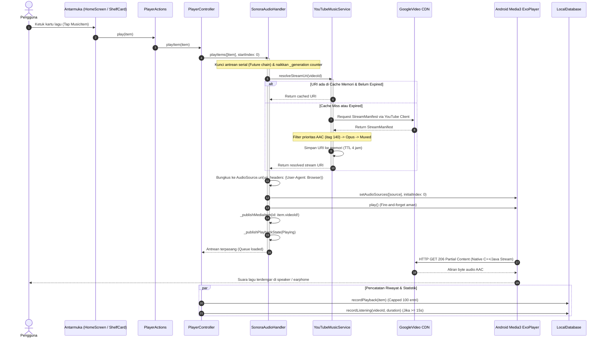
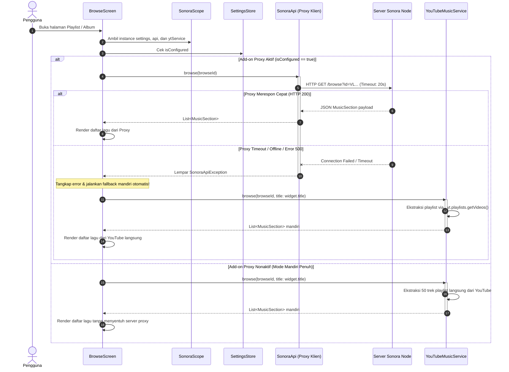
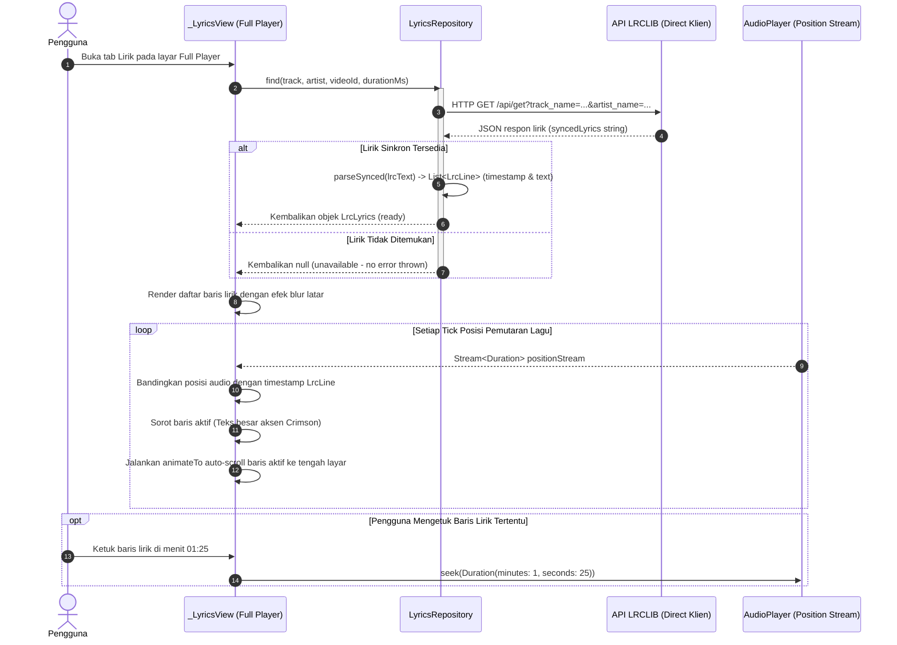
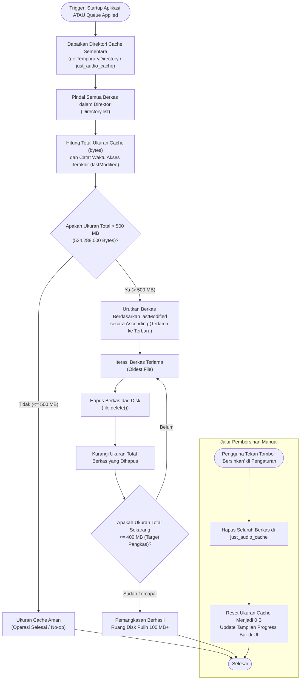

# Diagram Alur Proses & Sequence Diagram

Dokumen ini memaparkan pemodelan dinamis interaksi antar komponen sistem pada aplikasi **Sonora Flutter** menggunakan **Sequence Diagram** dan **Flowchart** berbasis sintaks Mermaid. Dokumen ini dirancang sebagai acuan bab perancangan proses dan interaksi sistem dalam laporan atau makalah ilmiah rekayasa perangkat lunak.

---

## 1. Sequence Diagram: Pemutaran Audio Mandiri (*Direct YouTube Streaming*)

Diagram sekuens berikut menggambarkan interaksi saat pengguna menekan tombol putar pada lagu hingga audio berhasil dialirkan langsung dari GoogleVideo CDN ke engine native Android Media3 ExoPlayer:

---

## 2. Sequence Diagram: Ekstensi Add-on Proxy & Auto-Fallback

Diagram berikut menjelaskan ketahanan sistem ketika fitur Add-on proxy diaktifkan, serta bagaimana sistem secara mulus beralih ke mode mandiri jika server proxy mengalami kendala jaringan atau *timeout*:

---

## 3. Sequence Diagram: Sinkronisasi Lirik Real-Time

Diagram berikut menggambarkan alur kerja modul lirik tersinkronisasi (*time-synced lyrics*) yang mengambil berkas `.lrc` langsung dari repositori LRCLIB:

---

## 4. Flowchart: Algoritma Manajemen Cache Audio (LRU 500 MB)

Untuk menjaga performa ruang penyimpanan perangkat Android agar tidak penuh oleh file audio streaming sementara, `AudioCacheService` menerapkan algoritma pemangkasan otomatis berbasis waktu akses (*Least Recently Used*):

