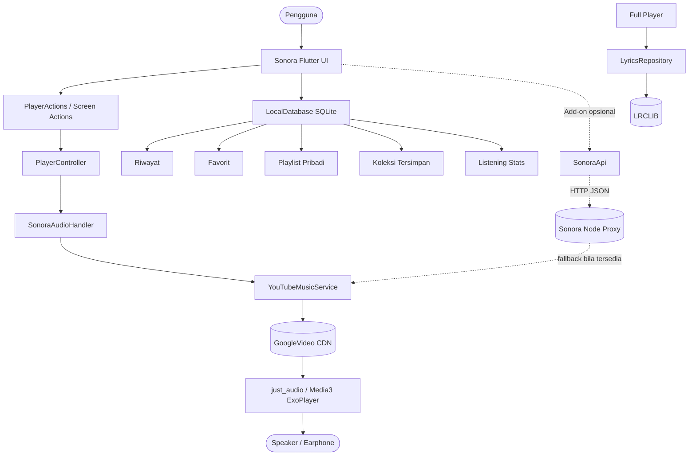
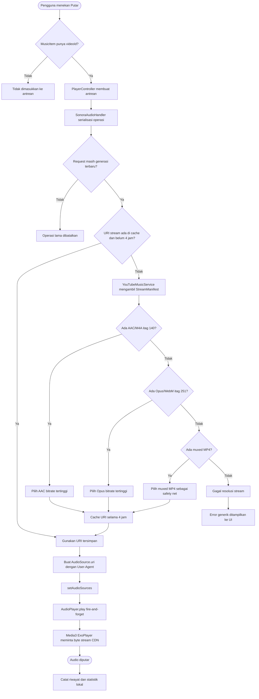
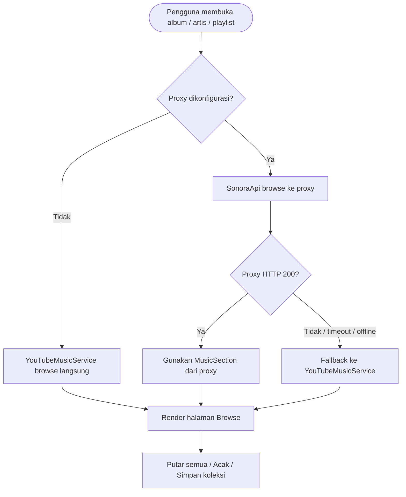
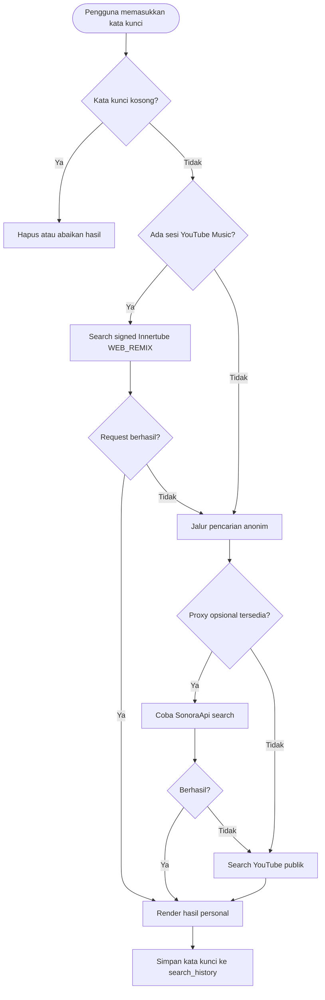
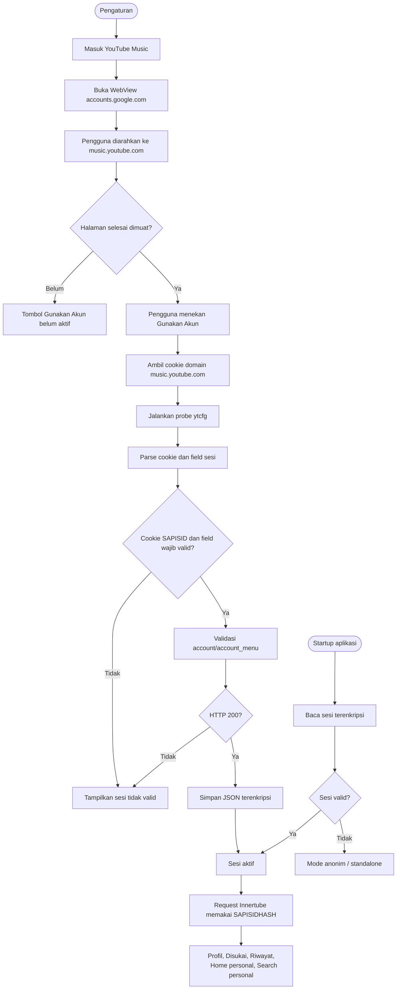
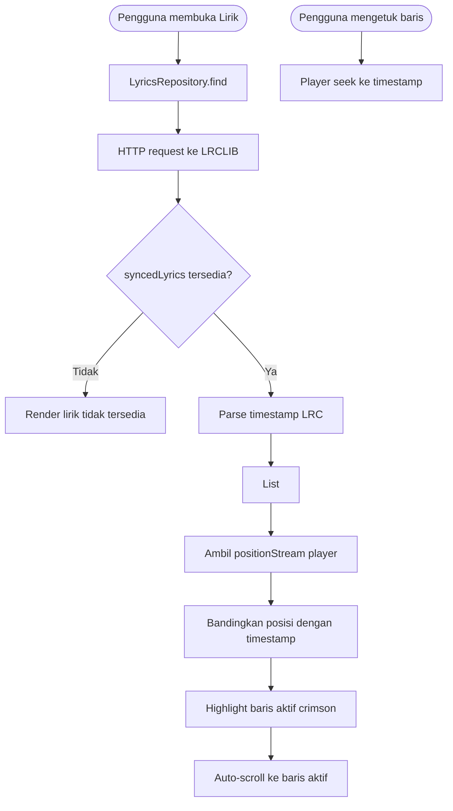
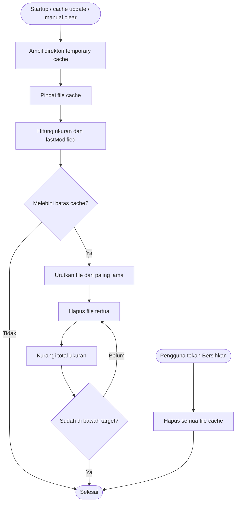
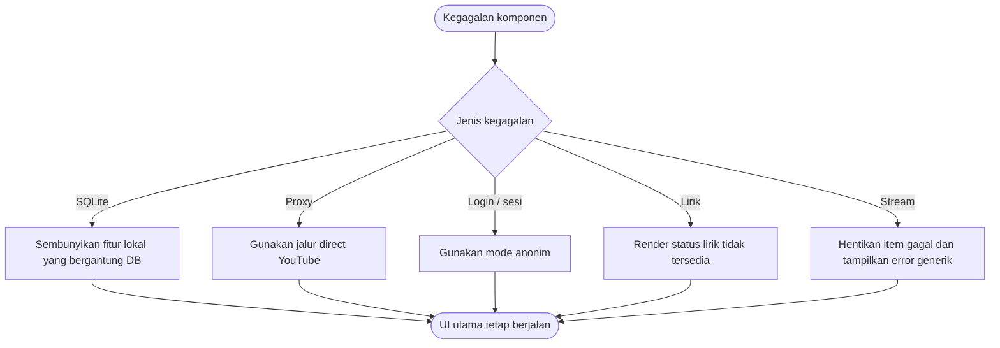

# Flowchart Sistem Sonora Flutter

Dokumen ini merangkum alur utama aplikasi Sonora Flutter berdasarkan arsitektur
standalone-first, direct streaming YouTube, add-on proxy opsional, penyimpanan
lokal, login YouTube Music, cache audio, dan lirik LRCLIB.

> Diagram menggunakan sintaks Mermaid dan dapat dirender oleh GitHub,
> GitLab, serta editor Markdown yang mendukung Mermaid.

## 1. Gambaran Umum Sistem

## 2. Bootstrap Aplikasi

```mermaid
flowchart LR
    Start([Aplikasi dimulai])
    Start --> Binding[WidgetsFlutterBinding.ensureInitialized]
    Binding --> Settings[Load SettingsStore]
    Settings --> API[Inisialisasi SonoraApi]
    API --> YT[Inisialisasi YouTubeMusicService]
    YT --> Auth[Restore sesi YouTube Music opsional]
    Auth --> Audio[Inisialisasi AudioSession dan AudioService]
    Audio --> DB{Buka LocalDatabase}
    DB -->|Berhasil| DBReady[Database tersedia]
    DB -->|Gagal| DBNull[Database null / graceful degradation]
    DBReady --> Cache[Pangkas cache audio di background]
    DBNull --> Cache
    Cache --> Scope[Pasang SonoraScope]
    Scope --> App[Render SonoraApp]
    App --> Ready([Aplikasi siap digunakan])
```

## 3. Alur Memutar Lagu Direct YouTube

## 4. Alur Browse dengan Proxy Opsional

## 5. Alur Pencarian

## 6. Login dan Pemulihan Sesi YouTube Music

## 7. Alur Lirik Tersinkronisasi

## 8. Alur Cache Audio

## 9. Alur Graceful Degradation

